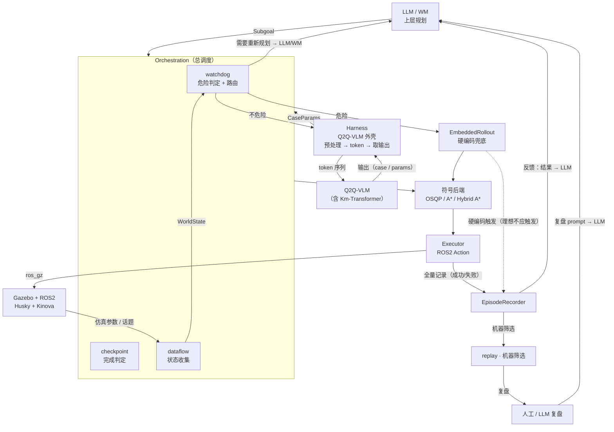

# 最终架构（Orchestration 调度）

更新日期：2026-10-19（**概念更正**）。本文是当前实现的**最终系统架构**，取代此前所有旧的架构图 / 流程。

> **更正说明（2026-10-19 晚）**：早前把「Q2QHarness」当成整个调度大框，是错的。
>
> - **orchestration** 才是整个架构（总调度）；
> - **harness** 只是 **Q2Q-VLM 这个节点的外壳**：把状态预处理成 token → 喂给 Q2Q-VLM → 把输出取回；
> - **Km-Transformer 属于 Q2Q-VLM**，不是与它并列的另一条策略。

Q2Q v2.0 的神经网络与方法细节仍见 [02-Q2Q当前架构](02-Q2Q当前架构.md)（研究层）；**系统分层以本文为准**。

## 分层（自上而下）

## 术语（必须分清）

| 名字 | 是什么 | 不是什么 |
|---|---|---|
| **Orchestration** | 整个架构的调度者：接子目标、收状态、路由、判完成、触发重规划、记账 | 不是模型，不产生动作参数 |
| **Harness** | **Q2Q-VLM 的外壳**：`WorldState + Subgoal → token`，调模型，再把输出整理成 `CaseParams` | 不是调度者，不决定子目标顺序 |
| **Q2Q-VLM** | 视觉-语言-动作模型；**Km-Transformer 是它的组成部分**（定性选 case + 定量出 params） | 不是与硬编码并列的「策略之一」 |
| **EmbeddedRollout** | 人工硬编码兜底 / benchmark 基线 / 数据自举 | 不是模型 |
| **符号后端** | OSQP / A* / Hybrid A*：把 case + params 解成轨迹 | 不产生策略 |

## 组件与文件（新五层目录）

| 层 / 组件 | 目录 | 职责 |
|---|---|---|
| 上层规划 | `q2q_harness/top/` | LLM/WM：任务 → 结构化 Subgoal |
| 总调度 | `q2q_harness/mid/` | orchestration：子目标推进、watchdog 路由、checkpoint 判定、重规划 |
| — 状态收集 | `mid/`（dataflow） | 话题 / 仿真参数 → WorldState |
| — 路由 | `mid/`（watchdog） | 危险 → 硬编码；不危险 → harness；失败 → 重规划 |
| — 完成判定 | `mid/`（checkpoint） | advance / continue |
| VLM 外壳 | `q2q_harness/low/`（harness） | 预处理成 token → 调 Q2Q-VLM → 输出 CaseParams |
| Q2Q-VLM | `low/`（含 Km-Transformer） | 策略选择 + 参数预测 |
| 硬编码 | `low/`（embedded_rollout） | 安全兜底 / benchmark / 自举 |
| 符号后端 | `low/`（symbolic_backend） | OSQP / A* / Hybrid A* |
| 执行 | `low/`（executor） | ROS2 Action → Gazebo / 真机 |
| 记录 | `q2q_harness/record/` | EpisodeRecorder（全量）+ replay（机器筛选） |
| 仿真 | `q2q_harness/sim/` | Gazebo / bridge / 机器人模型与传感器 |

## 连接关系（谁连谁）

| 从 → 到 | 传什么 | 类型（ROS2 视角） |
|---|---|---|
| LLM/WM → orchestration | `Subgoal` | topic（`q2q_interfaces/msg/Subgoal`，待定） |
| Gazebo/ROS2 → orchestration | `/joint_states`、`/odom`、`/scan`、`/clock`、`/tf` | topic |
| orchestration → harness | `WorldState + Subgoal` | service / 进程内调用（待定） |
| harness → Q2Q-VLM | token 序列 | 模型推理接口（待定） |
| Q2Q-VLM → harness | 输出（case 分布 / params） | 模型输出 |
| harness → orchestration | `CaseParams` | 返回值 |
| orchestration → 符号后端 | `case + params` | 进程内调用 / service |
| 符号后端 → executor | `Trajectory` | 进程内调用 |
| executor → Nav2 / MoveIt2 | `NavigateToPose` / `ExecuteTrajectory` | action |
| executor → recorder | 执行结果（成功 / 失败） | topic 或直接写盘 |
| orchestration → LLM/WM | 是否需要重规划 | topic / 事件 |
| recorder → replay → 人/LLM | digest / report | 文件 |

## 三条主路径

1. **正常**：orchestration 取子目标 → harness 预处理成 token → Q2Q-VLM → `CaseParams` → 符号后端 → executor → 仿真 → 记录。
2. **危险**：watchdog 判危险 → 绕过 VLM，直接用 EmbeddedRollout 的安全 case → 符号后端 → executor（同时记 `hardcoded_triggered`）。
3. **失败**：重试用尽 → watchdog 判「需要重新规划」→ 回 LLM/WM 产生新子目标；记录同步落盘供复盘。

## 关键约定

- **ROS2（rclpy）贯穿整个架构**：orchestration、harness 外壳、executor、记录都应是节点；Gazebo 只是 executor 通过 `ros_gz` 连出去的一端。
- **成功 / 失败全量落盘**：EpisodeRecorder 记录每一次尝试，供 replay 机器筛选。
- **一个节点只干一件事**：harness 只做「模型外壳」，不兼调度；orchestration 只做调度，不做模型推理。
- **安全阈值只由 watchdog 一处管理**，模型与 harness 无权放宽。
- **硬编码触发也入日志**（`kind: hardcoded_triggered`）：理想情况不应触发，触发次数是诊断指标。
- Q2Q v2.0 的 α/β、Cross-Attention、凸组合等属**研究层**细节，见 02。
