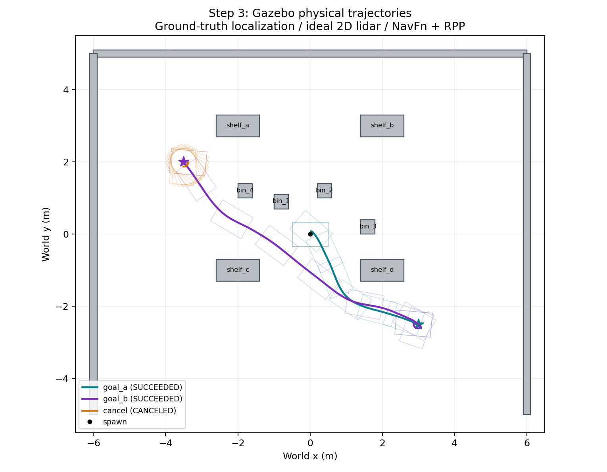

# 第 3 步修复与验收

日期：2026-10-22。**结论：第 3 步的仿真真值定位基线通过，两轮独立启动均完成两个导航目标与取消停稳。** 本结论不包含 AMCL 定位质量、原生 GPU 激光、MoveIt 执行、夹爪接触抓取或上层调度。

## 最终配置

- Ubuntu 22.04 / ROS2 Humble / Gazebo Fortress；沿用 Husky A200 + Kinova Gen3 Lite + 2F Lite 模型。
- VM 从 16 vCPU 调为 4 vCPU，保留约 12.5 GiB 内存。VirtualBox 日志表明使用 Hyper-V 兼容的 NEM 后端；此次未修改 Windows 虚拟化设置。
- 默认 Fast DDS，domain 0，不使用 localhost-only 或额外 DDS XML。Cyclone 只作隔离对照，不是交付依赖。
- Gazebo 原生 OdometryPublisher 提供真实车体位姿/速度与 odom TF；轮式里程计保留用于比较，不作为到位证据。
- 地图由当前仓库 SDF 生成，map 与 world 对齐；定位是显式真值基线。理想二维激光投影所有静态 box，不等同于物理激光高度截面。
- NavFn 全局规划 + Regulated Pure Pursuit 局部跟踪，5 Hz 控制；完整轮胎外缘轮廓约 0.9874×0.6693 m，局部碰撞检查保持启用。

## 两轮最终结果

门槛：两个目标均须 SUCCEEDED，map 与物理位姿的 xy 误差 ≤0.25 m、yaw 误差 ≤0.25 rad；线速度 <0.02 m/s、角速度 <0.05 rad/s 持续 ≥0.5 仿真秒。取消须已观测到运动、请求被接受、终态 CANCELED，取消至停稳验证 ≤3 秒墙钟。

| 轮次 | 目标 A (3,-2.5,0) | 目标 B (-3.5,2,3.14) | 取消至停稳验证 | 最终速度 |
|---|---|---|---|---|
| 1 | SUCCEEDED；0.126 m / 0.096 rad | SUCCEEDED；0.130 m / 0.101 rad | CANCELED；0.948 s | 线/角均为 0 |
| 2 | SUCCEEDED；0.135 m / 0.089 rad | SUCCEEDED；0.125 m / 0.090 rad | CANCELED；1.009 s | 线/角均为 0 |

取消测试在向 (3.5,4,0) 导航 8 秒后取消，本次发生在实际转向过程中；不是机器人静止时空发取消。停稳耗时含 ≥0.5 仿真秒的确认窗口。

两轮之间停止全部本次标记的子进程，确认没有残留 Gazebo，然后重新启动。这里的“独立启动”指仿真栈重启，不是每轮都重启 Ubuntu。两轮各四个控制器 active；最终确认仅一份 Gazebo 实例。

原生 Gazebo 查询第二轮取消后的实体位姿为 (-3.509830, 1.871980, yaw 1.462110)，和物理反馈记录 (-3.5098268, 1.8719764, yaw 1.4621126) 一致。该交叉检查避免仅凭 ROS 中的轮式积分误判车体已运动。

实时因子观测约 1.0（最终两个样本 0.9994、1.0067）。这是当前简化场景的观测，不是对后续视觉/抓取负载的性能承诺。

## 轨迹与避障证据

轨迹来自物理真值，不是规划路径。对位姿序列按 ≤0.025 m / ≤0.025 rad 插值，用完整矩形轮廓与世界中的 11 个静态 box 作二维分离轴重叠检查：两轮的 A/B/取消轨迹均为 0 个重叠样本。这是二维几何审计，不等价于三维接触传感器的碰撞认证。

`bin_2` 从 (0.4,0.6) 移到 (0.4,1.2)，为出生点保留转向范围；SDF、真值地图和理想激光使用同一场景。早期轮次在旧场景下发现了保守轮廓重叠，未沿用为最终避障证据。

## 主要修复

1. **运行基线**：撤销相互矛盾的 DDS 环境；本机 16→4 vCPU 后大幅改善调度表现。
2. **动作与生命周期**：BT 确认预算从 20 ms 调为 2000 ms，循环改为 100 ms；以控制器 active 状态触发导航，而不是固定等待 30 秒。生命周期心跳保留检测，VM 预算为 30 秒。启动查询 get_state 采用有总预算的只读重试，不重复发送运动目标。
3. **物理反馈**：发现轮式积分与实际车体运动严重不一致，接入 Gazebo 原生真值插件；差速器和 EKF 停止重复发布 odom TF。旧“车到了”的判断不再作为证据。
4. **轮胎接触**：补充 WheelSlip 所要求的摩擦方向，调整仿真打滑参数及轮距补偿。参数是此仿真基线的工程设置，未作实机标定。
5. **导航与地图**：采用真值地图/定位，保留 AMCL 为后续评测；用现有 RPP 处理大角度路径转向，保留碰撞检查；扩展 footprint 到轮胎外缘。
6. **验收器**：map 与物理位姿都验；检查朝向、数据新鲜度、持续停稳；取消必须被接受并返回 CANCELED；超时任务不留给下一轮。
7. **进程管理**：停止脚本原先仅关注父进程，复测发现遗留 Gazebo 子进程。已改为每次运行注入独立标记，追踪并终止本次所有子进程；新启动拒绝同名残留实例。不再使用大范围 pkill 清场。
8. **可复现性**：统一 PowerShell 入口；修正 SSH/构建退出码透传；修正二维射线平行 slab 漏判；生成补丁连续执行两次，确认真值插件只有一份。

过程中保留失败日志；未通过的 AMCL/DWB、孤儿进程污染及启动检查失败轮次没有计入最终通过结果。

原生插件依据：[Gazebo Fortress OdometryPublisher](https://gazebosim.org/api/sim/6/classignition_1_1gazebo_1_1systems_1_1OdometryPublisher.html)、[WheelSlip 的摩擦方向约定](https://gazebosim.org/api/sim/6/classignition_1_1gazebo_1_1systems_1_1WheelSlip.html)。

## 证据位置

- 最终轮 1：`.dsh/runs/2026-10-22-step3/final_round1/test_132821/`，三个 JSON、日志、summary.json；同级 stack.log。
- 最终轮 2：`.dsh/runs/2026-10-22-step3/final_round2/test_132957/`；同级 stack.log、independent_checks.txt。
- 图及审计：`docs/evaluations/assets/step3_final_round{1,2}_paths.{png,json}`。
- 修改前 VM 配置：`.dsh/runs/2026-10-22-step3/before_cpu_change.vbox`；无需复制虚拟磁盘。
- VM 原始目录：`~/.q2q/runs/step3_20261022_132622/test_132821` 和 `~/.q2q/runs/step3_20261022_132956/test_132957`。

## 运行与下一步

两轮独立验收后又完成 RViz 实时渲染一轮：A 0.1367 m / 0.1178 rad，B 0.1311 m / 0.1080 rad，取消至确认停稳 1.5921 s，三个终态全部合格。物理轨迹二维完整轮廓审计均 0 重叠。原始结果在 `.dsh/runs/2026-10-22-step3/live_demo/test_151806/`；[轨迹](assets/step3_live_demo_paths.png)、[审计 JSON](assets/step3_live_demo_paths.json)。RViz 约 17 FPS，不等于原生 Gazebo GUI/GPU 激光修复，也不将 headless RTF 外推为渲染负载性能。

交接见 [当前开发交接](../operations/当前开发交接.md)，原因与防复发见 [故障复盘](2026-10-22-故障复盘与防复发.md)。

完整命令见 [第 3 步导航运行](../operations/第3步导航运行.md)。Windows 统一入口为 `.dsh/step3.ps1` 的 Deploy / Start / Test / Status / Stop。

下一阶段可以进入第 4 步 MoveIt/夹爪执行。当前 top/mid/low/record 仍待实现，本次没有将仿真导航通过冒充为完整 orchestration 或 Harness 已完成。
